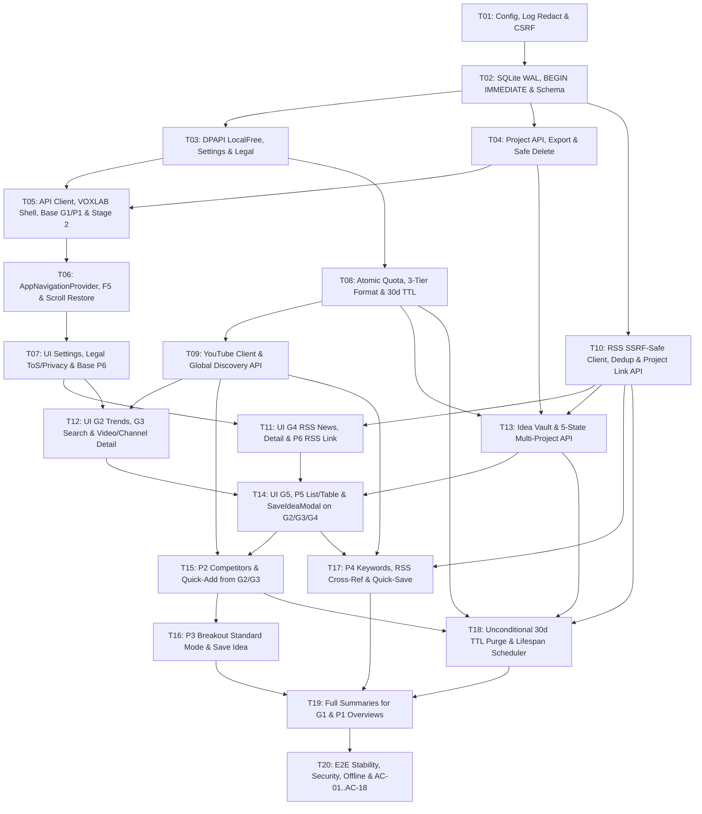

# Implementation Plan — Research Studio (MVP V1 — Standard Mode)

- **Dự án:** Research Studio
- **Giai đoạn:** Phase 5 — Plan Review (Đã rà soát & chuẩn hóa từ Bản kế hoạch Phase 4 được duyệt tại `GATE C`)
- **Ngày cập nhật:** 2026-11-16
- **Tài liệu nền:** [AGENT_WORKFLOW.txt](file:///f:/Source%20Code%20Tool/Reserch%20Studio/AGENT_WORKFLOW.txt) · [CONSTRAINTS.md](file:///f:/Source%20Code%20Tool/Reserch%20Studio/CONSTRAINTS.md) · [SPEC.md](file:///f:/Source%20Code%20Tool/Reserch%20Studio/SPEC.md)
- **Thứ tự Lifecycle Bắt buộc:** `Phase 4 (GATE C) → Phase 5 (Plan Review) → Phase 6 (UI/UX Design + Prototype Gate — GATE D) → Phase 7 (Build Auto: T01..T20)`.
- **Trạng thái hiện hành:** Chưa cài thêm dependency mới, chưa chạy Phase 6 UI/UX Gate và chưa viết code tính năng.

---

## 1. Tổng quan & Nguyên tắc Triển khai (Overview & Guiding Principles)

Kế hoạch sau rà soát phân rã [SPEC.md](file:///f:/Source%20Code%20Tool/Reserch%20Studio/SPEC.md) thành **6 Milestone (`M1`–`M6`)** với **20 Task (`T01`–`T20`)** tinh gọn, mỗi task chỉ chạm khoảng `3–5` file, kiểm thử độc lập và mở khóa luồng giá trị đầu–cuối sớm nhất:

- **Kiến trúc tối giản (YAGNI):** Modular Monolith 2 tiến trình cục bộ (`frontend` React 19 + TS + Vite 8 trên `127.0.0.1:5173`; `backend` Python 3.11 + FastAPI + SQLite trên `127.0.0.1:8000`). Không ORM nặng, không Redis/Celery/Docker, không router nặng phía frontend.
- **Chuẩn tuần tự Phase 6 (`GATE D`) trước Phase 7:** Hoàn tất thiết kế bố cục VOXLAB (Light/Dark) + Stitch (khi khả dụng) + prototype nhẹ tại **Phase 6 (`GATE D`)** rồi mới triển khai code sản phẩm từ `T01` tới `T20` ở Phase 7. Danh sách file UI trong `M2`–`M6` giữ ranh giới module hợp lý để thích ứng linh hoạt với cấu trúc component đã duyệt tại `GATE D` mà không khóa cứng thiết kế sớm.
- **Đưa `Idea Workspace` (`M4`) lên trước `Competitor & Keyword Research` (`M5`):** Giúp người dùng chạy trọn luồng **Tạo/Chọn Project → Khám phá YouTube/RSS → Lưu Ý tưởng → Quản lý 5 trạng thái đa Project → Xem lại Offline** ngay sau `M4`, đồng thời gắn nút `<SaveIdeaModal />` một lần vào các màn hình mà không phải sửa ngược 7 màn hình đã hoàn thiện ở cuối dự án.
- **Không xây trước tính năng Giai đoạn 2 / Derived Metrics:** Không AI (LM Studio/Ollama/Cloud), không `Outlier Multiplier`, `Views/ngày`, `Engagement Rate`, `Channel Median` hay công tắc mở khóa ẩn; 5 màn hình Giai đoạn 2 là placeholder trung thực gắn nhãn `Giai đoạn 2`.

---

## 2. Quyết định Kiến trúc Cốt lõi (Major Architecture Decisions — Đã Chuẩn hóa)

### ARCH-01 — Backend Tinh Gọn & An Toàn Đồng Thời Python 3.11 `sqlite3` + `asyncio`
- **Cấu trúc module thực tế của `backend/app/` (bỏ toàn bộ lớp pass-through thừa):**
  - `core/`: `config.py` (quản lý `%LOCALAPPDATA%\ResearchStudio\` / `RESEARCH_STUDIO_DATA_DIR`), `logging_setup.py` (`RotatingFileHandler` + `LogRedactionFilter`), `errors.py` (JSON lỗi chuẩn `{"error": {"code", "message", "details"}}`), `security.py` (Windows DPAPI kèm `kernel32.LocalFree`, chặn Localhost CSRF/Origin, kiểm tra URL/SSRF công khai).
  - `db/`: `connection.py`, `migrator.py`, `migrations/001_initial_schema.sql`.
  - `repositories/`: `settings_repo.py`, `project_repo.py`, `quota_repo.py`, `youtube_repo.py` *(bao hàm luôn TTL cleanup & snapshot)*, `rss_repo.py`, `keyword_repo.py`, `idea_repo.py`.
  - `clients/`: `youtube_client.py` (`httpx`), `rss_client.py` (`httpx` + `defusedxml` + strip HTML an toàn bằng stdlib `HTMLParser`).
  - `services/`: Chỉ giữ các service có orchestration/chính sách phức tạp: `quota_service.py`, `format_classifier.py`, `retention_service.py`, `discovery_service.py`, `competitor_service.py`, `keyword_service.py`, `rss_service.py`, `idea_service.py`, `scheduler_service.py`. Các API CRUD đơn giản (`settings`, `projects`, `breakout filter/flag`, `overviews`) gọi thẳng `repositories/` từ router, không tạo `settings_service.py`, `breakout_standard_service.py`, `overview_service.py`, `retention_repo.py` hay `refresh_repo.py`.
  - `routers/`: `system.py`, `projects.py`, `global_research.py`, `rss.py`, `ideas.py`, `project_competitors.py`, `project_keywords.py` (đăng ký đầy đủ tại `backend/app/main.py` cùng `/api/health`).
- **Quy tắc đồng thời `sqlite3` trên Python 3.11.9:**
  - Dùng mô hình **connection-per-operation ngắn hạn** đóng ngay trong `finally` (tránh khóa file `WinError 32` trên Windows khi test/backup).
  - Bật `PRAGMA journal_mode = WAL;` một lần khi khởi tạo/migration DB; mọi kết nối thiết lập `PRAGMA synchronous = NORMAL; PRAGMA foreign_keys = ON; PRAGMA busy_timeout = 5000;` và `isolation_level = None`.
  - Mọi transaction ghi phải dùng helper tường minh `BEGIN IMMEDIATE ... COMMIT / ROLLBACK` để `busy_timeout` phát huy tác dụng khi user ghi song song với scheduler nền (tránh deadlock `SHARED -> RESERVED` của giao dịch `DEFERRED` mặc định trong Python 3.11).
  - Route đồng bộ (`def`) chạy trên worker pool của FastAPI; route `async def` hoặc vòng lặp `asyncio` của Scheduler bắt buộc bọc lệnh DB và `Connection.backup()` trong `anyio.to_thread.run_sync`, tuyệt đối không block event loop và không giữ DB transaction mở trong lúc gọi HTTP.

### ARCH-02 — Mô hình SQLite 3 Tầng, Khóa Ngoại Bảo Toàn & Nullable Tombstone
- **Nhóm 1 — Thực thể gốc dùng chung (KHÔNG bắt buộc `project_id`):**
  - `youtube_channels` (`channel_id` PK) và `youtube_videos` (`video_id` PK): **Mọi cột dữ liệu lấy từ YouTube API (trừ khóa chính tự nhiên) bắt buộc cho phép `NULL`** (`title`, `description`, `handle`, `uploads_playlist_id`, `published_at`, `thumbnail_url`, `tags_json`, `view_count`, `like_count`, `comment_count`, `subscriber_count`, `video_count`, `duration_seconds`, `format_hint`, `format_hint_confidence`, `format_hint_basis`, riêng `source_format_status` reset về `'unknown'`) cùng `api_fetched_at`, `api_expires_at`, `api_purged_at`.
  - `youtube_video_snapshots` (`id`, `video_id`, `captured_at`, `view_count`, `like_count`, `comment_count`, `api_expires_at` — `<= 30 ngày lịch`).
  - `user_video_format_labels` (`video_id` PK, `manual_format` [`long_form | shorts`], `updated_at` — lưu vĩnh viễn, tách biệt hoàn toàn với `source_format_status`).
  - `search_sessions` & `search_session_items` (cache kết quả tìm kiếm/xu hướng `<= 30 ngày` kèm `api_expires_at`).
  - `rss_feeds` & `rss_articles` (khử trùng lặp theo `(feed_id, normalized_guid)` / `canonical_url_hash`).
  - `ideas` (`id` PK, `title`, `notes`, `source_type`, `source_ref_id`, `source_url`, `tags_json`, `in_global_vault`, `created_at`, `updated_at`).
- **Nhóm 2 — Bảng liên kết nhiều-nhiều (`project_id NOT NULL` + `UNIQUE(project_id, entity_id)`):**
  - `project_channels`, `project_videos` (`is_user_breakout`, `notes`, `marked_at` — phục vụ cả `P2` lẫn `P3. Video bứt phá` Standard Mode), `project_rss_feeds`, `project_ideas` (`status` [`new|researching|approved|produced|skipped`], `priority`, `project_angle`, `project_notes`, `published_video_url`, `status_updated_at`).
- **Nhóm 3 — Dữ liệu riêng của Project (`project_id NOT NULL`):**
  - `projects` (`id`, `name UNIQUE`, `description`, `region_code`, `relevance_language`, `target_format`, `created_at`, `updated_at`) và `project_keywords` (`id`, `project_id`, `keyword`, `priority`, `notes`, `last_scanned_at`, `created_at`).
- **Quy tắc Foreign Key an toàn:**
  - Chỉ đặt `ON DELETE CASCADE` cho khóa `project_id -> projects(id)` và các bảng cache thuần (`search_session_items -> search_sessions`, `rss_articles -> rss_feeds`).
  - Đặt `ON DELETE RESTRICT` cho các liên kết `video_id` / `channel_id` từ dữ liệu người dùng (`project_videos`, `project_channels`, `user_video_format_labels`) để lệnh xóa kỹ thuật không bao giờ vô tình xóa dây chuyền dữ liệu người dùng.
- **Backup & Xóa Project an toàn (`T04`):**
  - Trước migration mới: tạo backup bằng `sqlite3.Connection.backup()` vào `backups/` (giữ tối đa `3` bản `.db` gần nhất, tên file an toàn).
  - Khi người dùng xác nhận xóa Project (gõ đúng tên Project): ghi một **Project Recovery JSON** chỉ chứa dữ liệu người dùng của Project đó (`projects`, `project_keywords`, `project_channels`, `project_videos`, `project_rss_feeds`, `project_ideas` — **0** API Key, **0** `YouTube API Data`) vào `backups/` bằng tên file chuẩn hóa slug + `Path.resolve().is_relative_to(...)`, sau đó xóa `projects` trong SQLite (chỉ xóa thêm `ideas` có `in_global_vault = 0` và không còn gắn Project nào khác; giữ `100%` thực thể dùng chung và Kho chung).

### ARCH-03 — Atomic Dual-Bucket Quota Ledger Theo Giờ Thái Bình Dương (`America/Los_Angeles`)
- Khóa ngày quota là `datetime.now(ZoneInfo("America/Los_Angeles")).date().isoformat()` (sử dụng gói `tzdata` cho Windows). Mốc reset `00:00 PT` kế tiếp tính chính xác qua DST bằng `datetime.combine(pt_date + timedelta(days=1), time(0, 0), tzinfo=ZoneInfo("America/Los_Angeles")).astimezone(timezone.utc)`.
- **Đặt trước nguyên tử (`Atomic Reserve-Before-Call`):** Ngay trước mỗi lần gửi 1 HTTP request thật trong `youtube_client.py`, mở transaction `BEGIN IMMEDIATE` trên `quota_daily_ledger` để kiểm tra `hard_exhausted_until_utc` và cộng trước `1` unit vào đúng bucket (`search_queries` tối đa `100` hoặc `general_data` tối đa `10.000`). Nếu xảy ra `httpx.ConnectError` trước khi chạm máy chủ Google thì hoàn trả lại `1` unit; các lỗi `ReadTimeout` hay HTTP `4xx`/`5xx` (đã gửi tới Google) giữ nguyên `1` unit đã trừ.
- **Cấm Auto-Retry trên `search.list`:** Bucket `Search Queries` (`100 lượt/ngày`) lỗi tạm thời sẽ báo ngay cho người dùng quyết định thay vì tự gọi lại ngầm đốt quota; retry có giới hạn (`tối đa 2 lần` cho `429/502/503/504`) chỉ áp dụng cho endpoint đọc thuộc `General Data API` (có đặt trước `1` unit cho mỗi lượt thử lại) và RSS.

### ARCH-04 — TTL `30 ngày lịch`: Lọc Lúc Đọc + Dọn Vô Điều Kiện + Bảo Toàn Dữ Liệu Người Dùng
- **3 lớp bảo vệ đồng bộ (tách rời khỏi công tắc `auto_refresh_enabled`):**
  1. **Lớp lọc lúc đọc (`Read-Time Expiry Guard`):** Mọi truy vấn SQL đọc metadata/thống kê YouTube đều lọc `api_expires_at > :now_utc AND api_purged_at IS NULL` cho phần trường API, bảo đảm không bao giờ hiển thị `API Data` hết hạn ngay cả trước khi tác vụ dọn dẹp kịp chạy.
  2. **Dọn dẹp TTL tự động vô điều kiện (`Unconditional Local Purge`):** `purge_expired_api_data()` (`0` network calls) **luôn chạy khi khởi động FastAPI và theo nhịp timer nội bộ** bất kể `auto_refresh_enabled` đang Bật hay Tắt: xóa sạch `youtube_video_snapshots` và `search_sessions` quá hạn, xóa toàn bộ cột `API Data` (tombstone với `api_purged_at = now_utc`, đặt lại `source_format_status = 'unknown'`, `format_hint* = NULL`) cho `youtube_videos`/`youtube_channels` còn liên kết người dùng (`ideas`, `project_videos`, `project_channels`, `user_video_format_labels`), và chỉ `DELETE` hẳn dòng `youtube_channels` nếu không còn `youtube_videos` con hay liên kết người dùng nào tham chiếu.
  3. **Xóa ngay theo yêu cầu người dùng (`purge_all_youtube_api_data_by_user_request`):** Xóa sạch ngay lập tức toàn bộ `API Data` trong SQLite và đồng thời xóa các file backup `.db` cũ chứa `API Data` trong `backups/` (tuân thủ mốc `<= 7 ngày lịch` của `Developer Policies III.E.4.g`), trong khi giữ nguyên `100%` `projects`, `ideas`, `project_ideas`, `project_keywords`, `project_channels`, `project_videos`, `user_video_format_labels`, `rss_feeds` và `rss_articles`.

### ARCH-05 — Điều hướng Frontend & Khôi phục Trạng thái (`AppNavigationProvider` Tự Xây Hợp Nhất)
- **Đánh giá giải pháp tự xây vs thư viện ngoài (Mục B Plan Review):** Không cần cài `react-router` hay `wouter`, vì thư viện định tuyến phổ biến chỉ ánh xạ URL/query string và không tự quản lý được bộ ba trạng thái **chuyển Project nguyên tử (`activeProjectId` đồng bộ `route` để không rò 1 khung hình API cũ) + khôi phục `loadedPage` + khôi phục `scrollTop` sau khi list bất đồng bộ render xong** — nếu dùng router ngoài vẫn phải viết lớp bọc phức tạp tương đương. Giữ giải pháp tự xây `0` dependency là lựa chọn tối ưu với **5 chốt chặn bắt buộc** được bổ sung ngay vào `T06`:
  1. **Một Context nguyên tử duy nhất (`AppNavigationProvider`):** Gộp `(route, detailParams, activeProjectId)` vào một reducer nguyên tử để không bao giờ phát request cho Project cũ 1 frame khi Back/Forward giữa Project A và Project B.
  2. **Bền vững qua tải lại trang (`F5` / Hash + `sessionStorage`):** Đồng bộ route & `projectId` lên URL hash (`#/global/trends` hoặc `#/projects/{id}/videos?...`) kèm lưu mảng metadata stack nhẹ theo khóa `entryId` vào `sessionStorage` *(chỉ lưu `filters`, `sort`, `tab`, `loadedPage`, `scrollTop` — tuyệt đối không lưu dữ liệu danh sách từ API vào `history.state` hay `sessionStorage`)*.
  3. **`window.history.scrollRestoration = 'manual'` + `replaceState` tiết lưu:** Tắt cuộn tự động của trình duyệt; mỗi lần đổi `filters`/`sort`/`tab`/`loadedPage` hoặc cuộn trang (debounce/throttle), cập nhật mục hiện tại bằng `history.replaceState` **trước khi** người dùng bấm link đi tiếp hoặc bấm Back.
  4. **Khôi phục `loadedPage` trước `scrollTop`:** Khi quay lại danh sách dài đang ở trang `> 1`, nạp đủ số bản ghi (`loadedPage * pageSize`) trước rồi mới gán `container.scrollTop` trong `requestAnimationFrame` ngay khi trạng thái tải chuyển `ready`.
  5. **Phục hồi Project đã xóa trên `popstate`:** Nếu lịch sử Back/Forward trỏ về một `projectId` không còn tồn tại trong danh sách Projects hiện hành, tự động `replaceState` chuyển an toàn về Project còn lại gần nhất hoặc `G1. Tổng quan` kèm thông báo nhẹ trên UI thay vì vòng lặp lỗi `404`.

### ARCH-06 — Controlled Lifespan Scheduler (Làm mới Tự động Khi Mở App)
- Vòng lặp nhẹ trong `FastAPI lifespan` (`asyncio.Task`, hủy sạch khi tắt app), chạy tất cả thao tác DB qua `anyio.to_thread.run_sync`:
  - Luôn tách rời: công việc dọn TTL 30 ngày chạy độc lập (ARCH-04), còn **thu thập mạng tự động** chỉ chạy khi `auto_refresh_enabled = True`, sau trễ khởi động `30s` (`TUNING REQUIRED`).
  - Thứ tự ưu tiên thu thập mạng: **(1)** Video gắn `ideas`/`project_videos` sắp chạm hạn `25–29 ngày` (gộp lô tối đa 50 ID/lượt = `1 unit`), **(2)** Kênh đối thủ đang theo dõi đến hạn `12h` (mỗi kênh 1 lần chung), **(3)** `rss_feeds` đang bật đến hạn `4h` (`0` quota).
  - Tôn trọng cứng `auto_refresh_max_api_units_per_batch` (`15`), `auto_refresh_daily_quota_cap` (`3.000`), `quota_warning_ratio` (`80%`), khóa `in-flight` chống trùng với thao tác thủ công, và **tuyệt đối `0` lượt `search.list`**.

---

## 3. Bảo mật, Lỗi, Logging, Kiểm thử & Tương thích Tauri

- **Chống SSRF, DNS Rebinding, Redirect Bypass & Quá tải Bộ nhớ cho RSS (`T10`):**
  - URL nguồn RSS bắt buộc là `http://` hoặc `https://` hợp lệ, cấm chứa `username`/`password`.
  - Trước khi kết nối TCP: phân giải toàn bộ bản ghi DNS (`A`/`AAAA`) qua `socket.getaddrinfo`, kiểm tra **mọi** địa chỉ `ipaddress.ip_address(ip)` phải thỏa mãn `.is_global` (chặn `127.0.0.0/8`, `::1`, mạng LAN RFC1918, `169.254.0.0/16`, multicast, unspecified và IPv4-mapped private IP).
  - Đặt `follow_redirects=False` trong `httpx.AsyncClient`; xử lý thủ công tối đa `3` bước redirect và **kiểm tra lại toàn bộ quy tắc URL + DNS/IP ở mỗi đích `Location`**.
  - Đọc luồng dữ liệu qua `response.aiter_bytes()`, ngắt kết nối ngay lập tức nếu tổng byte vượt `rss_max_payload_bytes` (`5 MB`). Parse XML bằng `defusedxml` (chống XXE/XML bomb) và lọc sạch nội dung HTML bằng lớp con `html.parser.HTMLParser` loại bỏ trọn cây thẻ `<script>`/`<style>` + `html.unescape` (cấm regex sơ sài làm sót code text).
- **Chống Localhost Drive-By CSRF (`T01` + `T05`):**
  - Mọi request làm thay đổi dữ liệu (`POST`/`PUT`/`PATCH`/`DELETE`) trên `/api/v1/*` bắt buộc kèm header tùy chỉnh `X-Research-Studio-Client: local-web` (buộc trình duyệt gửi CORS `OPTIONS` preflight, chặn mọi website lạ gọi trực tiếp `fetch("http://127.0.0.1:8000/...")` dạng simple request) đồng thời kiểm tra `Origin` nằm trong allowlist `127.0.0.1`/`localhost` (sai trả `403`).
- **Bảo mật Windows DPAPI & Xử lý khóa hỏng (`T03`):**
  - Giải phóng bộ nhớ Win32 `DATA_BLOB.pbData` do `CryptProtectData`/`CryptUnprotectData` cấp phát qua `kernel32.LocalFree` trong khối `finally`.
  - Nếu `CryptUnprotectData` thất bại (do chép DB sang máy khác hoặc blob hỏng), ghi nhận trạng thái `api_key_status = "unreadable"` (`GET /settings` vẫn trả `200 OK` cho phép ghi đè/xóa khóa qua UI, các lệnh gọi YouTube trả mã `YOUTUBE_API_KEY_UNREADABLE`).
- **Tên file an toàn & Chống Path Traversal (`T04`):** Slugify ASCII an toàn cho file JSON export/backup, chặn các tên thiết bị cấm trên Windows (`CON`, `PRN`, `AUX`, `NUL`, `COM1`–`COM9`, `LPT1`–`LPT9`) và kiểm chứng `Path.resolve().is_relative_to(...)`.
- **Chiến lược kiểm thử (`Test Strategy`):** Backend `unittest` + `TestClient` (`RESEARCH_STUDIO_DATA_DIR` tạm, transport giả lập cho YouTube/RSS, test SSRF/CSRF/DPAPI/concurrency/TTL/isolation `project_id`); Frontend `tsc -b`, `oxlint` (`0` warnings/errors), `vite build`, và **Chrome DevTools MCP** kiểm tra DOM, Light/Dark WCAG AA, `F5`/Back/Forward/`scrollTop` và `/api/*` thực tế.
- **Tương thích Tauri (tương lai):** API tương đối `/api/v1/...`, chỉ bind `127.0.0.1`, dữ liệu tách tại `%LOCALAPPDATA%\ResearchStudio\`.

---

## 4. Danh mục Dependency Cuối cùng (Chưa cài trong Phase 5)

> Kiểm chứng thực tế trên venv Python `3.11.9` Windows của dự án cho thấy: `zoneinfo.available_timezones()` hiện trả về tập rỗng (ném `ZoneInfoNotFoundError` khi gọi `ZoneInfo("America/Los_Angeles")`), và `httpx` chưa có mặt nên `fastapi.testclient.TestClient` không chạy được nếu thiếu `httpx`. Do đó giữ nguyên **3 gói Python tối thiểu** (sẽ cài khi vào Phase 7 `T01`, chi phí `0 USD`, giấy phép chuẩn [CONSTRAINTS.md](file:///f:/Source%20Code%20Tool/Reserch%20Studio/CONSTRAINTS.md)):

| Thành phần | Gói dự kiến | Giấy phép | Mục đích bắt buộc |
|---|---|---|---|
| **Backend (`pip`)** | `tzdata>=2024.1` | `Apache-2.0` | Cơ sở dữ liệu múi giờ IANA cho `America/Los_Angeles` trên Windows 11. |
| **Backend (`pip`)** | `httpx>=0.27.0,<1.0.0` | `BSD-3-Clause` | HTTP client `asyncio` có `follow_redirects=False`, streaming `aiter_bytes`, timeout chi tiết và hỗ trợ `TestClient`. |
| **Backend (`pip`)** | `defusedxml>=0.7.1,<1.0.0` | `PSF-2.0` | Parse XML RSS/Atom an toàn, chặn XXE và entity expansion. |
| **Frontend (`npm`)** | *(Không thêm dependency runtime mới)* | — | Dùng trực tiếp `React 19 + TypeScript + Vite 8 + CSS Variables`; SVG nội tuyến gọn nhẹ. |

---

## 5. Tổng quan 6 Milestones & 20 Tasks (`T01` – `T20`)

> Thứ tự đã tối ưu: **M1 Core Foundation → M2 UI Foundation → M3 Research Data → M4 Idea Workspace → M5 Competitor, Breakout & Keyword → M6 Integration, Controlled Auto-Refresh & Stability**. Danh sách đầy đủ 9 trường cho từng task nằm tại [tasks/todo.md](file:///f:/Source%20Code%20Tool/Reserch%20Studio/tasks/todo.md).

| Milestone | Phạm vi chính | Tasks | Kết quả chạy thử thực tế sau Milestone |
|---|---|---|---|
| **M1 — Core Foundation** | Runtime/Logging/CSRF (`T01`), SQLite `WAL` + `BEGIN IMMEDIATE` + Schema 3 tầng nullable (`T02`), DPAPI + Settings + Legal (`T03`), Project CRUD + Safe Backup/Export (`T04`) | `T01`–`T04` (`4` tasks) | **Chạy thử Backend thật qua `/api/docs`**: tạo/sửa/export/xóa Project an toàn, lưu & che API Key DPAPI, kiểm chứng cô lập SQLite. |
| **M2 — UI Foundation** *(sau khi qua `Phase 6 — GATE D`)* | API Client + Theme VOXLAB + Shell 16 mục có `G1`/`P1` cơ bản & 5 mục Giai đoạn 2 (`T05`), `AppNavigationProvider` bền vững qua `F5` & Project Selector duy nhất (`T06`), UI Cài đặt chung/Pháp lý & `P6` cơ bản (`T07`) | `T05`–`T07` (`3` tasks) | **Chạy thử App Desktop trên `127.0.0.1:5173`**: Light/Dark VOXLAB, 16 màn hình, tạo/đổi Project, `F5`/Back/Forward giữ đúng state & `scrollTop`, lưu API Key & Pháp lý. |
| **M3 — Research Data** | Atomic 2-bucket Quota + 3-tier Format + TTL 30 ngày + lọc lúc đọc (`T08`), YouTube Client (`0` auto-retry search) + Xu hướng/Tìm kiếm (`T09`), RSS/Atom chống SSRF/XXE/HTML (`T10`), UI `G4` RSS + liên kết RSS Project tại `P6` (`T11`), UI `G2` Xu hướng & `G3` Tự do + Chi tiết Video/Kênh (`T12`) | `T08`–`T12` (`5` tasks) | **Chạy thử Khám phá Dữ liệu thật Global + Offline**: xem Xu hướng YouTube, Tìm tự do, đọc RSS công khai (`0` quota) kể cả khi mất mạng, gán Nhãn định dạng thủ công. |
| **M4 — Idea Workspace** *(đưa lên sớm)* | Backend Kho Ý tưởng chung + Liên kết đa Project + 5 trạng thái (`T13`), UI `G5` Kho chung, `P5` Quản lý ý tưởng (Danh sách/Bảng gọn), Chi tiết Ý tưởng & nút `<SaveIdeaModal />` gắn sẵn vào `G2`, `G3`, `G4` (`T14`) | `T13`–`T14` (`2` tasks) | **Chạy thử Trọn luồng Cốt lõi đầu–cuối**: Tạo Project → Tìm YouTube / Đọc RSS → Lưu ngay thành Ý tưởng → Gắn nhiều Project với 5 trạng thái độc lập → Đọc lại Offline. |
| **M5 — Competitor, Breakout & Keyword Research** | `P2. Theo dõi đối thủ` + thêm nhanh kênh từ `G2`/`G3` (`T15`), `P3. Video bứt phá` Standard Mode (`T16`), `P4. Nghiên cứu từ khóa` + đối chiếu RSS Project + lưu nhanh từ khóa từ `G3` (`T17`) | `T15`–`T17` (`3` tasks) | **Chạy thử Nghiên cứu Chuyên sâu theo Project**: theo dõi đối thủ tiết kiệm quota, lọc `Video bứt phá` Standard Mode + đánh dấu thủ công, quét Từ khóa + RSS. |
| **M6 — Integration & Stability** | Dọn TTL 30 ngày vô điều kiện + Lifespan Auto-Refresh có kiểm soát (`T18`), Hoàn thiện số liệu tổng hợp `G1. Tổng quan` & `P1. Tổng quan dự án` (`T19`), E2E Offline/Quota/Security/DevTools cho `AC-01`..`AC-18` (`T20`) | `T18`–`T20` (`3` tasks) | **Chạy thử Toàn bộ MVP V1 (`11/16` màn hình thật)** với auto-refresh an toàn, TTL 30 ngày chuẩn chính sách và bảo mật kiểm chứng đầy đủ. |

### Sơ đồ Phụ thuộc (`Dependency Graph`)

---

## 6. Rủi ro Lớn nhất & Biện pháp Kiểm soát Sau Plan Review

| Task (`HIGH RISK`) | Rủi ro cốt lõi | Chốt chặn kỹ thuật đã bổ sung |
|---|---|---|
| **`T02` — SQLite Concurrency & Schema** | Deadlock `DEFERRED` trong Python 3.11 + `WinError 32` trên Windows + vỡ FK khi dọn `API Data` 30 ngày. | Connection-per-operation đóng trong `finally`, `BEGIN IMMEDIATE` cho mọi write, `anyio.to_thread.run_sync`, mọi cột API nullable + `ON DELETE RESTRICT` trên liên kết `video_id`/`channel_id`. |
| **`T03` — Windows DPAPI & Keys** | Rò rỉ vùng nhớ plaintext Win32 hoặc lỗi `500` không vào được Settings khi blob DPAPI hỏng/chuyển máy. | Giải phóng `LocalFree` trong `finally`, trả `api_key_status = "unreadable"` cho phép người dùng ghi đè khóa mới, kết hợp CSRF header `X-Research-Studio-Client`. |
| **`T08` — Quota PT, 3-Tier Format & TTL** | Trừ sai khi chạy đồng thời, `search.list` tự retry đốt quota, hoặc đọc nhầm dữ liệu quá 30 ngày chưa kịp dọn. | Đặt trước nguyên tử trong `BEGIN IMMEDIATE`, tắt auto-retry trên `search.list`, dùng `ZoneInfo("America/Los_Angeles")` + `tzdata`, lọc `api_expires_at > now` ở mọi truy vấn đọc. |
| **`T09` — YouTube Client** | `ReadTimeout` hoặc lỗi `4xx` làm hụt sổ cái so với Google Cloud Console, hoặc lẫn chỉ số dẫn xuất bị cấm. | Trừ 1 unit theo từng wire attempt, chỉ hoàn khi `ConnectError` trước kết nối; parse `ISO 8601 duration` thuần, cấm tính `Outlier`/`Views/ngày`. |
| **`T10` — RSS SSRF & Untrusted Input** | Feed URL trỏ về `127.0.0.1:8000` / LAN / `169.254.169.254` hoặc redirect từ URL công khai về localhost; payload XML bomb / HTML script. | Kiểm tra `.is_global` mọi IP DNS phân giải, `follow_redirects=False` kiểm tra từng hop (`<= 3`), cắt luồng byte quá `5 MB`, `defusedxml` + `HTMLParser` lọc bỏ subtree `<script>`/`<style>`. |
| **`T06` — Navigation & Scroll Restore** | Mất đồng bộ stack khi `F5`, lệch `scrollTop` khi list tải bất đồng bộ từ trang `> 1`, hoặc Back vào Project đã xóa. | Atomic reducer `(route, activeProjectId)`, URL hash + `sessionStorage` metadata, `scrollRestoration = 'manual'`, nạp đủ `loadedPage` trước `scrollTop`, redirect sạch nếu Project đã xóa. |
| **`T18` — TTL Purge & Scheduler** | Tắt `auto_refresh_enabled` làm ngưng dọn dữ liệu 30 ngày vi phạm chính sách YouTube, hoặc scheduler ngốn hết quota. | Tách hàm dọn TTL 30 ngày chạy vô điều kiện độc lập với công tắc `auto_refresh_enabled`; giữ trễ khởi động `30s`, batch `<= 15 units` và trần tự động `3.000 units/ngày`. |

---

## 7. Các Vấn đề Cần User Phê duyệt Trước Phase 6

1. **Xác nhận cập nhật Plan sau Review (`6` Milestones / `20` Tasks):**
   - Đảo **Milestone 4 — Idea Workspace (`T13`–`T14`)** lên trước **Milestone 5 — Competitor, Breakout & Keyword Research (`T15`–`T17`)**, đồng thời tách `T11` (RSS + liên kết RSS cho Project ở `P6`) khỏi `T12` (Global YouTube + Chi tiết Video/Kênh) để rút ngắn thời gian có luồng giá trị đầu–cuối hoàn chỉnh và tránh sửa ngược 7 màn hình.
   - Bổ sung các chốt chặn bảo mật & đồng thời bắt buộc (SSRF + Redirect IP cho RSS, Localhost CSRF header `X-Research-Studio-Client`, giải phóng `LocalFree` & xử lý lỗi giải mã DPAPI, `BEGIN IMMEDIATE` + `anyio.to_thread` cho SQLite Python 3.11, dọn TTL 30 ngày vô điều kiện + lọc lúc đọc, và 5 chốt chặn `AppNavigationProvider` bền vững qua `F5`).
2. **Xác nhận bước kế tiếp là Phase 6 — UI/UX Design + Prototype Gate (`GATE D`):**
   - Sử dụng Stitch (khi khả dụng) cùng phong cách VOXLAB Light/Dark để duyệt kiến trúc thông tin, bố cục và prototype đại diện **trước** khi cài 3 gói `tzdata`, `httpx`, `defusedxml` và bắt đầu triển khai `T01`–`T20` ở Phase 7.
